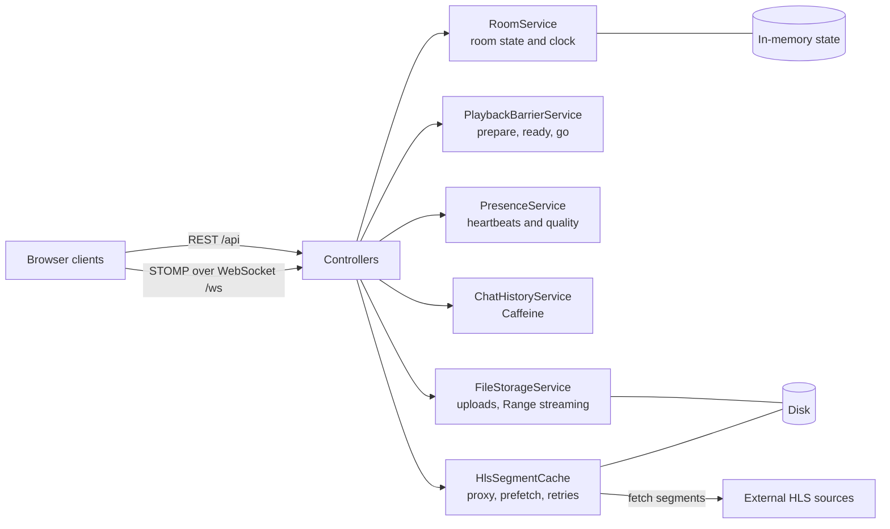

# sync-watch-backend

[](https://github.com/MishkaCube/sync-watch-backend/actions/workflows/ci.yml)


Backend for **Sync Watch**, a small pet project for watching videos together in sync. One person creates a room, shares the link, and every participant's player stays at the same position: play, pause, seek and buffering are coordinated by the server.

Frontend: [`sync-watch-frontend`](https://github.com/MishkaCube/sync-watch-frontend) (TypeScript).

## Features

- **Rooms.** Create a room, join it by id. Rooms live in memory and are removed automatically after a period of inactivity (default 60 minutes, only when empty).
- **Server-authoritative playback clock.** Each room has a clock (`position`, `playing`, `updatedAt`). Clients receive clock events and correct their drift against it.
- **Synchronized start (readiness barrier).** On *play* the server asks everyone to seek and prebuffer (`prepare`), waits until all participants report `ready` (or a 6 second timeout), then sends `go`. This removes start-time differences caused by one client still buffering.
- **Buffering coordination.** If a client stalls, the room clock is paused and resumed when nobody is buffering.
- **Presence.** Clients send heartbeats with a self-reported connection quality; entries expire after 12 seconds without a heartbeat. The lobby list is broadcast to the room.
- **Chat.** Per-room chat with history (messages are capped at 500 characters).
- **File upload and streaming.** Upload a video (up to 4 GB) and stream it back with HTTP `Range` support (`206 Partial Content`), so every client can seek.
- **HLS proxy with segment cache.** Rewrites `.m3u8` manifests so segments go through the backend, caches segments on disk, prefetches ahead of the playback position, and retries failed downloads.
- **Optional external catalog integration.** A feature-flagged hook that starts a separate Python helper process. It is configuration-only and not required to run the backend.

## Tech stack

Java 21 · Spring Boot 3.3 · Spring WebSocket (STOMP over SockJS) · Gradle · Lombok · Caffeine · GitHub Actions

## How synchronization works

```
client A ── play ──▶  /app/room/{id}/event
                         │
                         ▼
                 PlaybackBarrierService
                  1. pause clock at target position
                  2. broadcast "prepare"   ──▶ all clients seek + prebuffer
                  3. clients reply "ready"
                  4. all ready (or 6 s timeout)
                  5. broadcast "go" + play clock ──▶ everyone starts together
```

- Clients send events to `/app/room/{roomId}/event` and subscribe to `/topic/room.{roomId}`.
- Event types: `play`, `pause`, `seek`, `source-change`, `source-reset`, `buffering-start`, `buffering-end`, `chat`, `sync`, `ready`, `presence`.
- `seek` is applied directly without the barrier. A pause, prepare, play cycle conflicts with native fullscreen players on Safari, so other clients catch up through drift correction instead.

## API

| Method | Path | Description |
|---|---|---|
| `POST` | `/api/rooms` | Create a room |
| `GET` | `/api/rooms/{id}` | Room info with live participant count |
| `GET` | `/api/rooms/{id}/clock` | Current room clock |
| `GET` | `/api/rooms/{id}/chat` | Recent chat messages |
| `POST` | `/api/files/upload` | Upload a video and broadcast `source-change` to the room |
| `GET` | `/api/files/{fileId}` | Stream a file (supports `Range`) |
| `GET` | `/api/hls/manifest?url=` | Fetch and rewrite an HLS playlist |
| `GET` | `/api/hls/segment?url=` | Serve a cached HLS segment |
| `GET` | `/api/hls/warmup?manifest=&time=` | Prefetch segments from a playback position |
| `GET` | `/api/health` | Health check |
| `GET` | `/api/config` | Feature flags for the UI |

WebSocket endpoint: `/ws` (SockJS fallback). Heartbeat: 1 s.

## Architecture



## Getting started

Requirements: JDK 21.

```bash
./gradlew bootRun
```

The server starts on `http://localhost:8080`. Run the frontend on `http://localhost:5173` (the default allowed origin).

### Run with Docker

```bash
docker compose up --build
```

This builds a multi-stage image (JDK 21 build, JRE 21 runtime, non-root user, health check) and exposes the backend on `http://localhost:8080`.

## Tests

```bash
./gradlew test
```

The suite has 42 tests and runs in a few seconds:

- **Unit tests** for the playback clock, room state (including buffering coordination and recovery after a client disconnects), participants, presence and chat history.
- **Barrier tests** with a mocked message broker: `go` is sent only after every participant is ready, duplicate `ready` events are counted once, and `cancel` drops a pending start.
- **End-to-end tests** that boot the whole application on a random port and drive it like a real client over REST and STOMP/WebSocket: create a room, subscribe, press play, answer `prepare` with `ready`, and receive `go` plus a playing clock.

GitHub Actions runs the tests on every pull request and push to `develop`, and checks that the Docker image builds.

### Configuration

Defaults live in `src/main/resources/application.yml`:

| Property | Default | Meaning |
|---|---|---|
| `server.port` | `8080` | HTTP port |
| `syncwatch.room.idle-ttl-minutes` | `60` | Remove a room after this time empty and idle |
| `syncwatch.room.cleanup-interval-ms` | `900000` | How often the cleanup runs |
| `spring.servlet.multipart.max-file-size` | `4GB` | Upload size limit |
| `rezka.feature.enabled` / `rezka.service.enabled` | see file | Toggle the optional catalog integration |

Any credentials for optional integrations must be provided through environment variables (for example `REZKA_SERVICE_EMAIL`, `REZKA_SERVICE_PASSWORD`) and must never be committed.

## Deployment

A GitHub Actions workflow (`.github/workflows/deploy.yml`) builds the `bootJar` with JDK 21 on every push to `develop`, copies it to the server over SSH, restarts the systemd service and waits for `/api/health` to report healthy. Server credentials are stored as repository secrets.

## Project structure

```
src/main/java/com/syncwatch
├── config/       WebSocket (STOMP) config, connection events, optional helper runner
├── controller/   REST + STOMP controllers (rooms, files, HLS proxy, player sync, health, config)
├── model/        Room, RoomClock, events and DTOs
└── service/      Rooms, participants, presence, playback barrier, HLS cache, cleanup scheduler
```

## Known limitations

- Room state is in memory: one instance, no persistence, rooms are lost on restart.
- No authentication: anyone with a room link can join.
- The 6 second barrier timeout and the 12 second presence expiry are not covered by tests yet.
- CORS is configured for local development.

## Roadmap

- Tests for the barrier timeout and presence expiry (needs an injectable clock)
- Redis (or similar) for shared room state and horizontal scaling
- Authentication and room access control

## License

Not specified yet.
